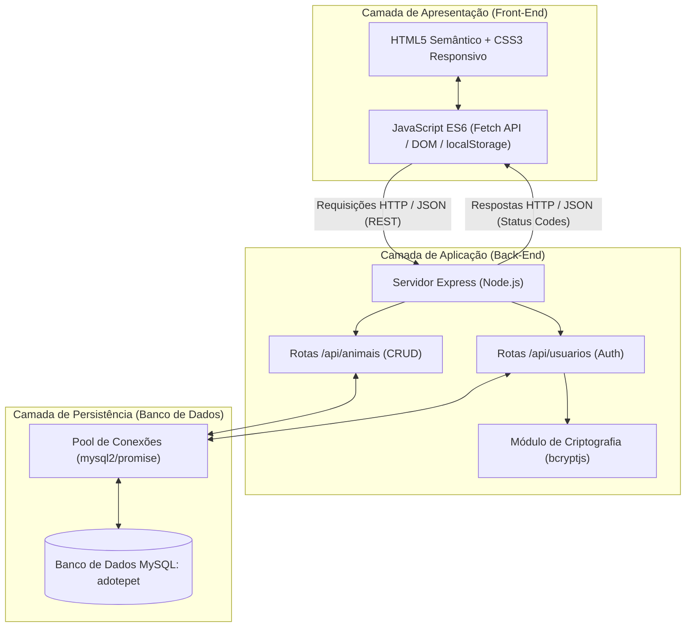
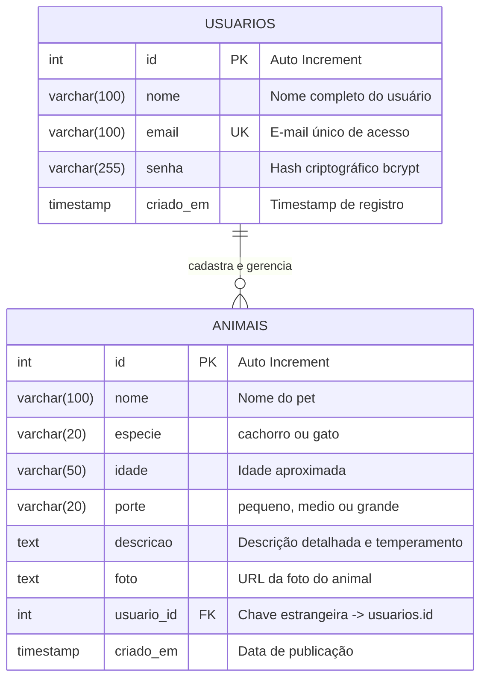
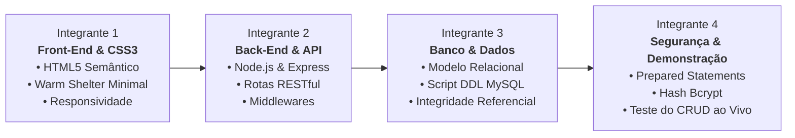

# 🐾 DOCUMENTAÇÃO TÉCNICA DO SISTEMA ADOTEPET
**Projeto Integrador de Engenharia de Software — 2º Semestre**

---

## 1. Identificação do Projeto e Equipe

| Informação | Detalhe |
|---|---|
| **Nome do Sistema** | **AdotePet** — Plataforma Cidadã de Adoção Responsável de Animais |
| **Curso** | Bacharelado em Engenharia de Software |
| **Semestre Letivo** | 2º Semestre |
| **Componente Curricular** | Projeto Integrador / Desenvolvimento Web Full Stack e Bancos de Dados |
| **Equipe de Desenvolvimento** | • Integrante 1: Front-End, Semântica HTML5 & Responsividade CSS3<br>• Integrante 2: Back-End, Node.js & Arquitetura RESTful<br>• Integrante 3: Engenharia de Dados, Modelagem DDL & MySQL<br>• Integrante 4: Testes de Software, Segurança & Validação do CRUD |

---

## 2. Visão Geral e Escopo do Sistema

### 2.1. Objetivo Acadêmico
Desenvolver uma aplicação Web Full Stack completa e funcional aplicando os fundamentos de Engenharia de Software adquiridos no 2º semestre, contemplando:
1. Construção de interfaces ricas e acessíveis em **HTML5**;
2. Estilização modular e responsiva em **CSS3 puro** seguindo o Design System pré-estabelecido;
3. Criação de API REST em **JavaScript (Node.js/Express)** com controle de estados e conexões assíncronas;
4. Modelagem relacional e persistência de dados em **MySQL** através do driver `mysql2` com proteção ativa contra vulnerabilidades (SQL Injection e exposição de credenciais).

### 2.2. Requisitos do Sistema

#### Requisitos Funcionais (RF)
- **RF01 — Cadastro de Usuário:** O sistema deve permitir o cadastro de novos tutores e voluntários com nome, e-mail e senha com confirmação.
- **RF02 — Autenticação de Usuário:** O sistema deve autenticar o usuário validando o e-mail e o hash da senha cadastrada.
- **RF03 — Cadastro de Animais (Create):** Usuários autenticados devem poder cadastrar animais informando nome, espécie (cão ou gato), idade, porte (pequeno, médio ou grande), descrição e link de foto.
- **RF04 — Listagem de Animais (Read):** Qualquer visitante deve poder visualizar a lista de animais disponíveis para adoção, carregada diretamente do banco de dados.
- **RF05 — Filtragem e Busca de Animais:** A listagem deve permitir filtros combinados por espécie, porte e pesquisa textual por nome.
- **RF06 — Detalhamento do Pet (Read):** O sistema deve exibir página detalhada de cada animal com dados completos e identificação do tutor responsável.
- **RF07 — Alteração de Dados (Update):** O responsável pelo cadastro do animal deve poder editar suas informações a qualquer momento.
- **RF08 — Exclusão de Animal (Delete):** O responsável pelo cadastro deve poder excluir o registro do animal da base de dados com confirmação de segurança.

#### Requisitos Não Funcionais (RNF)
- **RNF01 — Segurança de Senhas:** Senhas devem ser armazenadas exclusivamente em formato de hash criptográfico unidirecional via algoritmo `bcrypt` com fator de custo (*salt rounds*) igual a 10.
- **RNF02 — Segurança de Dados (SQL Injection):** Todas as consultas ao banco MySQL devem empregar consultas preparadas (*Prepared Statements*) com parâmetros sanitizados.
- **RNF03 — Isolamento de Configurações:** Nenhuma credencial de banco ou porta de rede deve estar *hardcoded* no código público, utilizando variáveis de ambiente via arquivo `.env`.
- **RNF04 — Responsividade:** O layout deve se adaptar fluidamente a resoluções de telas móveis (Smartphones), intermediárias (Tablets) e desktops.
- **RNF05 — Desempenho e Reuso de Conexões:** O backend deve utilizar um *Connection Pool* para gerenciar conexões concorrentes com o banco de dados.

---

## 3. Arquitetura de Software

O sistema adota o padrão de **Arquitetura em Três Camadas (3-Tier Architecture)** desacoplada, utilizando o modelo cliente-servidor com comunicação assíncrona baseada em REST e JSON.



### 3.1. Justificativa das Tecnologias
- **HTML5 & CSS3 Puros:** Atende rigorosamente à diretriz pedagógica de não utilizar frameworks complexos (como React ou Angular), consolidando os fundamentos de manipulação de DOM e estilização nativa.
- **Node.js + Express:** Permite utilizar uma única linguagem (JavaScript) em toda a stack, viabilizando rotas concisas, middlewares eficientes e alta produtividade.
- **MySQL2/Promise:** Driver otimizado para Node.js com suporte nativo a `async/await`, permitindo código assíncrono limpo sem encadeamento de *callbacks* (*callback hell*).
- **BcryptJS:** Biblioteca padrão da indústria para hashing de senhas com *salting*, prevenindo ataques de dicionário e *rainbow tables*.

---

## 4. Modelagem do Banco de Dados Relacional (MySQL)

### 4.1. Diagrama Entidade-Relacionamento (DER)



### 4.2. Dicionário de Dados

#### Tabela: `usuarios`
| Campo | Tipo de Dado | Nulo? | Chave | Descrição e Regras |
|---|---|---|---|---|
| `id` | `INT` | Não | **PK** | Identificador único e sequencial do usuário (`AUTO_INCREMENT`) |
| `nome` | `VARCHAR(100)` | Não | - | Nome completo do usuário tutor |
| `email` | `VARCHAR(100)` | Não | **UK** | E-mail corporativo ou pessoal; possui índice único (`UNIQUE`) |
| `senha` | `VARCHAR(255)` | Não | - | String contendo o hash gerado pelo algoritmo bcrypt (custo 10) |
| `criado_em` | `TIMESTAMP` | Sim | - | Data e hora automática do cadastro (`DEFAULT CURRENT_TIMESTAMP`) |

#### Tabela: `animais`
| Campo | Tipo de Dado | Nulo? | Chave | Descrição e Regras |
|---|---|---|---|---|
| `id` | `INT` | Não | **PK** | Identificador único e sequencial do animal (`AUTO_INCREMENT`) |
| `nome` | `VARCHAR(100)` | Não | - | Nome fantasia de registro do pet |
| `especie` | `VARCHAR(20)` | Não | - | Classificação taxonômica simplificada (`cachorro` ou `gato`) |
| `idade` | `VARCHAR(50)` | Não | - | Idade aproximada (ex: `1 ano`, `6 meses`, `Filhote`) |
| `porte` | `VARCHAR(20)` | Não | - | Porte físico do animal (`pequeno`, `medio`, `grande`) |
| `descricao` | `TEXT` | Não | - | Texto detalhado sobre temperamento, histórico de resgate e saúde |
| `foto` | `TEXT` | Não | - | URL externa ou caminho estático da fotografia |
| `usuario_id` | `INT` | Não | **FK** | Referência à tabela `usuarios(id)` com `ON DELETE CASCADE` |
| `criado_em` | `TIMESTAMP` | Sim | - | Data e hora de publicação na plataforma |

---

## 5. Implementação das 4 Operações CRUD

A tabela a seguir sumariza a API REST desenvolvida no arquivo `backend/routes/animais.js`:

| Operação CRUD | Método HTTP | Endpoint | Payload de Entrada (JSON) | Código de Sucesso | Ação no MySQL |
|---|---|---|---|---|---|
| **CREATE** (Cadastrar) | `POST` | `/api/animais` | `{"nome", "especie", "idade", "porte", "descricao", "foto", "usuario_id"}` | `201 Created` | `INSERT INTO animais (...) VALUES (?, ...)` |
| **READ** (Consultar Todos) | `GET` | `/api/animais` | Parâmetros via Query String: `?especie=&porte=&busca=` | `200 OK` | `SELECT a.*, u.nome FROM animais a JOIN usuarios u ...` |
| **READ** (Consultar por ID) | `GET` | `/api/animais/:id` | Parâmetro de rota: `:id` | `200 OK` | `SELECT a.*, u.nome FROM animais WHERE a.id = ?` |
| **UPDATE** (Alterar) | `PUT` | `/api/animais/:id` | `{"nome", "especie", "idade", "porte", "descricao", "foto"}` | `200 OK` | `UPDATE animais SET nome = ?, ... WHERE id = ?` |
| **DELETE** (Excluir) | `DELETE` | `/api/animais/:id` | Parâmetro de rota: `:id` | `200 OK` | `DELETE FROM animais WHERE id = ?` |

---

## 6. Padrões de Segurança Implementados

### 6.1. Prevenção Contra Injeção de SQL (SQL Injection)
O sistema não utiliza concatenação de strings em nenhuma instrução SQL. Todos os parâmetros recebidos do usuário passam por consultas parametrizadas (*Prepared Statements*):
```javascript
// Exemplo implementado no backend:
const sql = 'INSERT INTO animais (nome, especie, idade, porte, descricao, foto, usuario_id) VALUES (?, ?, ?, ?, ?, ?, ?)';
await pool.query(sql, [nome, especie, idade, porte, descricao, fotoFinal, idUsuario]);
```

### 6.2. Criptografia Segura de Senhas
A senha do usuário jamais trafega para o banco em texto puro. Ao cadastrar:
```javascript
const saltRounds = 10;
const senhaHash = await bcrypt.hash(senha, saltRounds);
// O hash de 60 caracteres resultante é persistido
```
Na autenticação, o método `bcrypt.compare(senhaInformada, usuario.senha)` valida a compatibilidade de forma segura contra ataques de temporização.

### 6.3. Isolamento de Credenciais (.env)
A conexão com o MySQL não expõe dados no repositório. O arquivo `.env` gerencia credenciais locais:
```env
DB_HOST=localhost
DB_USER=root
DB_PASSWORD=
DB_NAME=adotepet
DB_PORT=3306
```

---

## 7. Roteiro de Apresentação da Equipe (Divisão de Fala)

Para uma apresentação acadêmica coesa de 10 a 15 minutos, sugerimos a divisão do conteúdo entre os 4 estudantes:



### Roteiro Detalhado por Integrante:

#### 🗣️ Integrante 1 — Apresentação Visual e Front-End (3 minutos)
- **Tópicos:**
  - Introdução do tema social: conectar animais resgatados a lares amorosos;
  - Explicação da identidade visual *Warm Shelter Minimal*: tons verde laurel (`#52B788`), bege/linho (`#FAF8F5`) e botões arredondados que transmitem acolhimento;
  - Apresentação da responsividade do CSS3 (Flexbox e Grid) funcionando em dispositivos móveis e desktop;
  - Semântica e acessibilidade dos formulários HTML5 (`required`, tipos específicos e tags label).

#### 🗣️ Integrante 2 — Arquitetura Back-End e Rotas (3 minutos)
- **Tópicos:**
  - Explicação do servidor HTTP estruturado em Node.js com o framework Express;
  - Organização modular da pasta `backend/` separando `server.js`, `database.js` e a pasta `routes/`;
  - Demonstração dos códigos de status HTTP apropriados (`200 OK`, `201 Created`, `400 Bad Request`, `404 Not Found`, `500 Server Error`);
  - Explicação da integração com o Front-End através da `Fetch API` assíncrona.

#### 🗣️ Integrante 3 — Engenharia de Dados e MySQL Workbench (3 minutos)
- **Tópicos:**
  - Demonstração do Script DDL `database/adotepet.sql` importado e executado no MySQL Workbench;
  - Explicação da modelagem das tabelas `usuarios` e `animais`;
  - Justificativa da chave estrangeira `usuario_id` com a regra `ON DELETE CASCADE` (caso um usuário seja removido, seus animais cadastrados são tratados com integridade);
  - Demonstração dos dados de teste inseridos (*seed data*).

#### 🗣️ Integrante 4 — Segurança e Demonstração Prática do CRUD (4 minutos)
- **Tópicos:**
  - Explicação das medidas de segurança adotadas: *Prepared Statements* (contra SQL Injection) e *Bcrypt* (proteção de senhas);
  - **Demonstração Prática ao Vivo perante o Professor:**
    1. **Create:** Cadastrar um novo pet pelo formulário e mostrar a inclusão;
    2. **Read:** Mostrar o pet renderizado na tela de listagem e demonstrar o filtro por espécie/porte;
    3. **Update:** Abrir os detalhes do pet cadastrado, clicar em *Editar*, alterar um dado e salvar;
    4. **Delete:** Clicar em *Excluir*, confirmar no modal do navegador e comprovar a remoção imediata da listagem e do MySQL.

---

## 8. Matriz de Testes de Aceitação do CRUD

| ID | Cenário de Teste | Ação Executada | Resultado Esperado | Status |
|---|---|---|---|---|
| **TC01** | Validação de Entrada | Enviar cadastro de animal com campos vazios | Formulário bloqueia o envio pelo HTML5 e o backend retorna status `400` | **Aprovado** ✅ |
| **TC02** | Operação CREATE | Preencher dados válidos e submeter formulário | Registro gravado no MySQL; retorna `201 Created` e exibe notificação Toast | **Aprovado** ✅ |
| **TC03** | Operação READ Geral | Acessar página `animais.html` | Requisição `GET /api/animais` popula os cards com foto, idade e porte | **Aprovado** ✅ |
| **TC04** | Filtros de Pesquisa | Clicar no filtro de gatos ou cães | API filtra no banco com cláusula `WHERE especie = ?` e atualiza a visualização | **Aprovado** ✅ |
| **TC05** | Operação READ Específica | Clicar em "Ver Detalhes" de um card | Página carrega dados completos e realiza `JOIN` com o usuário tutor | **Aprovado** ✅ |
| **TC06** | Operação UPDATE | Editar porte/descrição de animal cadastrado | Executa `PUT /api/animais/:id` com prepared statement; dados atualizados no banco | **Aprovado** ✅ |
| **TC07** | Operação DELETE | Confirmar exclusão na tela de detalhes | Executa `DELETE /api/animais/:id`; registro é removido e página redireciona | **Aprovado** ✅ |
| **TC08** | Integridade de Senhas | Verificar coluna `senha` no MySQL Workbench | Senha exibida sob forma de hash ilegível `$2a$10$...` | **Aprovado** ✅ |

---

## 9. Conclusão Acadêmica

O desenvolvimento do sistema **AdotePet** consolida os pilares fundamentais da Engenharia de Software no ciclo inicial de formação:
- Adoção de arquitetura em camadas clara e desacoplada;
- Atendimento estrito aos requisitos funcionais e não funcionais estabelecidos;
- Aplicação de boas práticas de segurança, tipagem relacional e integridade de dados;
- Criação de uma solução socialmente relevante com interface moderna e amigável.
