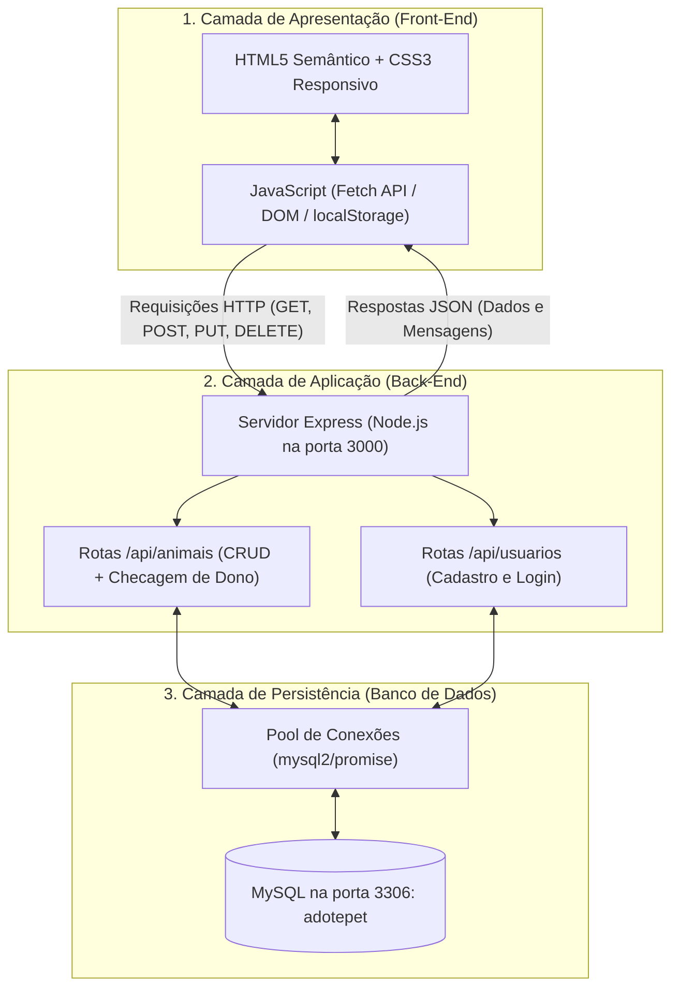
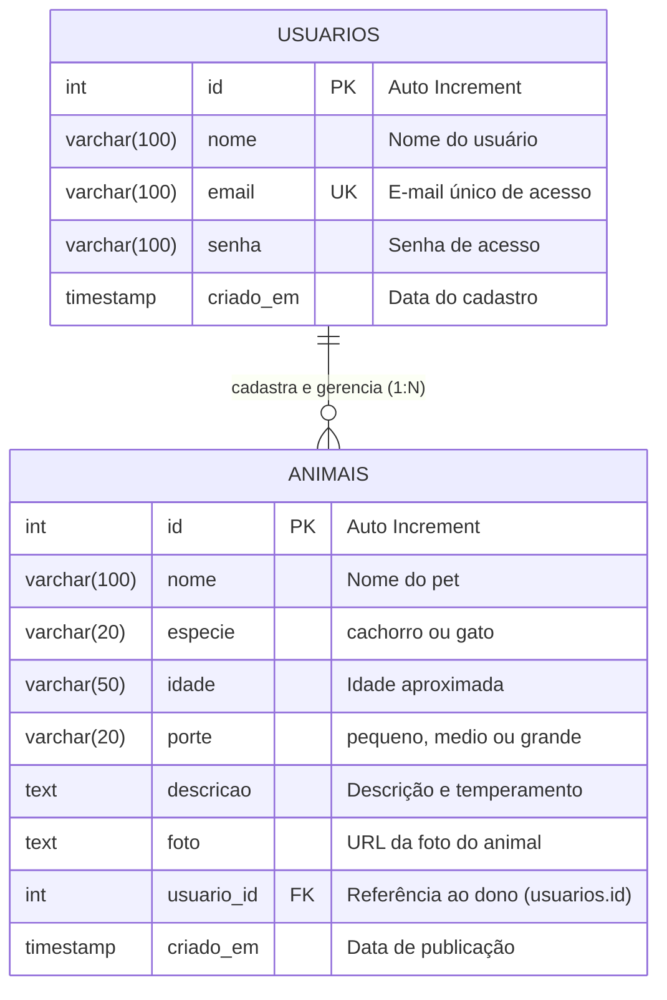
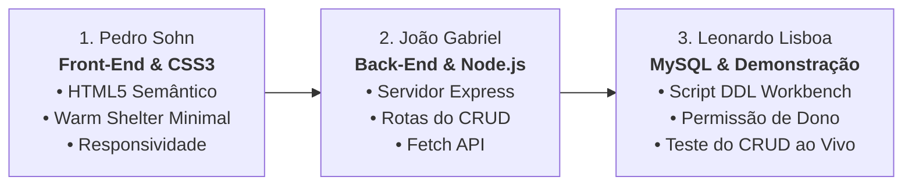

# 🐾 DOCUMENTAÇÃO TÉCNICA DO SISTEMA ADOTEPET
**Projeto Integrador de Engenharia de Software — 2º Semestre**

---

## 1. Identificação do Projeto e Equipe

| Informação | Detalhe |
|---|---|
| **Nome do Sistema** | **AdotePet** — Plataforma de Adoção Responsável de Animais |
| **Curso** | Bacharelado em Engenharia de Software |
| **Semestre Letivo** | 2º Semestre |
| **Componente Curricular** | Projeto Integrador / Desenvolvimento Web Full Stack e Banco de Dados |
| **Ambiente de Execução** | 100% Local (`localhost:3000` / MySQL `localhost:3306`) |
| **Equipe de Desenvolvimento** | • Pedro Sohn: Front-End, Semântica HTML5 & Estilização CSS3<br>• João Gabriel: Back-End, Node.js & Rotas Express<br>• Leonardo Lisboa: Banco de Dados MySQL, Regras de Negócio e Apresentação |

---

## 2. Visão Geral e Escopo do Sistema

### 2.1. Objetivo Acadêmico
Desenvolver uma aplicação Web Full Stack funcional, limpa e didática aplicando os fundamentos de Engenharia de Software adquiridos no 2º semestre, contemplando os quatro artefatos obrigatórios:
1. **Formulários de cadastro em HTML5**: estruturação semântica, validações nativas e seletores intuitivos;
2. **Estilização em CSS3**: design minimalista (*Warm Shelter Minimal*), botões arredondados, paleta de cores verde/branco/bege e layout responsivo;
3. **Backend em JavaScript com Node.js e Express**: criação de rotas REST locais e conexão direta com o MySQL através do driver `mysql2`;
4. **Script SQL/DDL**: criação do banco de dados relacional `adotepet`, tabelas com chaves primárias e estrangeiras, integridade referencial e dados iniciais de teste (*seeds*).

---

### 2.2. Requisitos do Sistema

#### Requisitos Funcionais (RF)
- **RF01 — Cadastro de Usuário:** O sistema permite o cadastro de novos usuários com nome completo, e-mail e senha.
- **RF02 — Login e Autenticação:** O sistema valida e-mail e senha diretamente no banco de dados e salva a sessão ativa no navegador (`localStorage`).
- **RF03 — Cadastro de Animais (Create):** Apenas usuários logados podem cadastrar animais informando nome, espécie (cão ou gato), porte (pequeno, médio ou grande), idade aproximada, foto e descrição. O pet fica vinculado ao ID do usuário que o cadastrou.
- **RF04 — Consulta de Animais (Read):** Visitantes e usuários podem visualizar a lista completa de animais disponíveis para adoção, carregada do MySQL.
- **RF05 — Filtragem de Animais:** A listagem permite filtrar os animais por espécie (Todos, Cães ou Gatos) de forma simples e direta.
- **RF06 — Detalhes do Animal (Read):** Exibição de página detalhada com foto, espécie, porte, idade e história do animal.
- **RF07 — Alteração de Dados (Update):** Somente o usuário que cadastrou o pet tem permissão para editar suas informações.
- **RF08 — Exclusão de Animal (Delete):** Somente o usuário que cadastrou o pet tem permissão para excluí-lo do sistema com confirmação de segurança.

#### Requisitos Não Funcionais (RNF) e Regras de Negócio
- **RNF01 — Arquitetura 100% Local:** A API e o banco de dados rodam exclusivamente na máquina local (`localhost`), sem dependência de serviços em nuvem ou internet.
- **RNF02 — Segurança contra SQL Injection:** Uso de consultas preparadas (*Prepared Statements*) com marcadores `?` em todas as operações no MySQL.
- **RNF03 — Controle de Acesso por Dono (Regra de Negócio):** 
  - No Front-End: os botões de **Editar** e **Excluir** só aparecem se o usuário logado for o dono do animal (`usuario_logado.id === animal.usuario_id`).
  - No Back-End: as rotas `PUT` e `DELETE` verificam no banco se o solicitante é o responsável pelo cadastro, retornando status `403 Forbidden` caso contrário.
- **RNF04 — Código Limpo e Acessível:** Estruturado sem complexidades excessivas, permitindo que estudantes do 2º semestre compreendam e expliquem cada linha de código com clareza.
- **RNF05 — Isolamento de Configurações:** Credenciais de conexão do MySQL organizadas em arquivo `.env`.

---

## 3. Arquitetura de Software

O sistema adota o padrão de **Arquitetura em Três Camadas (3-Tier)** desacoplada:



---

## 4. Modelagem do Banco de Dados Relacional (MySQL)

### 4.1. Diagrama Entidade-Relacionamento (DER)



### 4.2. Dicionário de Dados

#### Tabela: `usuarios`
| Coluna | Tipo | Nulo? | Chave | Descrição |
|---|---|---|---|---|
| `id` | `INT` | Não | **PK** | Identificador único sequencial (`AUTO_INCREMENT`) |
| `nome` | `VARCHAR(100)` | Não | - | Nome completo do usuário tutor |
| `email` | `VARCHAR(100)` | Não | **UK** | E-mail do usuário; possui restrição de unicidade (`UNIQUE`) |
| `senha` | `VARCHAR(100)` | Não | - | Senha de acesso cadastrada |
| `criado_em` | `TIMESTAMP` | Sim | - | Data e hora automática do cadastro (`DEFAULT CURRENT_TIMESTAMP`) |

#### Tabela: `animais`
| Coluna | Tipo | Nulo? | Chave | Descrição |
|---|---|---|---|---|
| `id` | `INT` | Não | **PK** | Identificador único sequencial (`AUTO_INCREMENT`) |
| `nome` | `VARCHAR(100)` | Não | - | Nome do animal |
| `especie` | `VARCHAR(20)` | Não | - | Espécie: `cachorro` ou `gato` |
| `idade` | `VARCHAR(50)` | Não | - | Idade aproximada (ex: `1 ano`, `6 meses`) |
| `porte` | `VARCHAR(20)` | Não | - | Porte do animal: `pequeno`, `medio` ou `grande` |
| `descricao` | `TEXT` | Não | - | Histórico de resgate, comportamento e vacinas |
| `foto` | `TEXT` | Não | - | Link/URL da fotografia do animal |
| `usuario_id` | `INT` | Não | **FK** | Referência ao tutor em `usuarios(id)` com `ON DELETE CASCADE` |
| `criado_em` | `TIMESTAMP` | Sim | - | Data e hora de publicação do registro |

---

## 5. Implementação das 4 Operações CRUD

A API foi desenvolvida em `backend/routes/animais.js` seguindo o padrão RESTful:

| Operação CRUD | Método HTTP | Rota Local | Entrada de Dados | Resposta HTTP | Ação Executada no MySQL |
|---|---|---|---|---|---|
| **CREATE** (Cadastrar) | `POST` | `/api/animais` | JSON no Body com dados do pet e `usuario_id` | `201 Created` | `INSERT INTO animais (...) VALUES (?, ...)` |
| **READ** (Listar Todos) | `GET` | `/api/animais` | Nenhuma (busca geral) | `200 OK` | `SELECT * FROM animais ORDER BY id DESC` |
| **READ** (Detalhes) | `GET` | `/api/animais/:id` | Parâmetro de rota `:id` | `200 OK` | `SELECT * FROM animais WHERE id = ?` |
| **UPDATE** (Alterar) | `PUT` | `/api/animais/:id` | JSON no Body com novos dados e `usuario_id` | `200 OK` | `UPDATE animais SET ... WHERE id = ?` *(após checar dono)* |
| **DELETE** (Excluir) | `DELETE` | `/api/animais/:id` | Query string `?usuario_id=` | `200 OK` | `DELETE FROM animais WHERE id = ?` *(após checar dono)* |

---

## 6. Padrões de Segurança e Regras de Negócio

### 6.1. Proteção Contra SQL Injection (Prepared Statements)
O backend não concatena strings diretamente nos comandos SQL. Todas as instruções utilizam o marcador `?`:
```javascript
const sql = 'INSERT INTO animais (nome, especie, idade, porte, descricao, foto, usuario_id) VALUES (?, ?, ?, ?, ?, ?, ?)';
await pool.query(sql, [nome, especie, idade, porte, descricao, fotoFinal, usuario_id]);
```
O driver `mysql2` trata os dados antes de enviá-los ao MySQL, impedindo injeção de comandos maliciosos.

### 6.2. Regra de Negócio: Controle de Dono do Registro
Para impedir que um usuário ou visitante apague ou altere pets alheios:
- **No Front-End (`frontend/js/script.js`):**
  ```javascript
  const usuario = obterUsuarioLogado();
  if (usuario && usuario.id === animal.usuario_id) {
    // Exibe botões de Editar e Excluir
  } else {
    // Oculta os botões para visitantes e outros usuários
  }
  ```
- **No Back-End (`backend/routes/animais.js`):**
  ```javascript
  const [animais] = await pool.query('SELECT * FROM animais WHERE id = ?', [id]);
  if (usuario_id && animais[0].usuario_id != usuario_id) {
    return res.status(403).json({ mensagem: 'Você só pode excluir animais cadastrados por você!' });
  }
  ```

---

## 7. Roteiro de Apresentação da Equipe (Divisão entre os 3 Alunos)

Uma sugestão prática de apresentação de 10 a 12 minutos dividida igualmente entre os 3 integrantes:



### O que cada integrante deve falar:

#### 🗣️ 1. Pedro Sohn — Apresentação da Interface e Front-End (3 a 4 min)
- Apresentar o propósito social do AdotePet;
- Explicar o HTML5 semântico dos formulários (`required`, inputs tipados de e-mail e seleção de espécie/porte);
- Explicar a identidade visual em CSS3 (*Warm Shelter Minimal*): cores verde botânico (`#52B788`), bege/linho (`#FAF8F5`) e botões arredondados com layout responsivo para celular e computador.

#### 🗣️ 2. João Gabriel — Arquitetura Back-End e Rotas (3 a 4 min)
- Explicar que a aplicação roda sobre o **Node.js** com framework **Express** na porta 3000 de forma 100% local;
- Mostrar a estrutura de pastas organizada (`server.js`, `database.js` e pasta `routes/`);
- Explicar as 4 rotas do CRUD de animais (`POST`, `GET`, `PUT`, `DELETE`) e como o Front-End se comunica com elas via `fetch()`.

#### 🗣️ 3. Leonardo Lisboa — Banco de Dados, Regras de Negócio e Demonstração ao Vivo (4 a 5 min)
- Abrir o **MySQL Workbench** e mostrar o banco `adotepet`, a tabela `usuarios`, a tabela `animais` e a chave estrangeira com `ON DELETE CASCADE`;
- Explicar o uso de *Prepared Statements* contra SQL Injection e a regra de que apenas o dono pode editar ou excluir o pet;
- **Executar a demonstração prática ao vivo perante o professor:**
  1. Mostrar a lista carregada do banco e os botões de filtro (Cães / Gatos);
  2. Fazer login com `admin@adotepet.com` / `12345678`;
  3. **CREATE:** Cadastrar um novo pet e mostrar a mensagem de sucesso;
  4. **READ:** Abrir a página de detalhes do pet recém-cadastrado;
  5. **UPDATE:** Clicar em *Editar*, alterar a idade do animal e salvar;
  6. **DELETE:** Clicar em *Excluir*, confirmar no alerta e mostrar que o pet sumiu da listagem e do MySQL Workbench.

---

## 8. Matriz de Testes de Aceitação do CRUD

| Teste | Ação Executada | Resultado Esperado | Status |
|---|---|---|---|
| **CREATE** | Cadastrar animal logado como usuário tutor | Registro salvo no MySQL; redireciona para a lista | **Aprovado** ✅ |
| **READ** | Acessar a página `animais.html` | Mostra todos os animais salvos no banco de dados | **Aprovado** ✅ |
| **FILTRO** | Clicar em "Somente Cães" ou "Somente Gatos" | Filtra os cards na tela instantaneamente | **Aprovado** ✅ |
| **UPDATE** | Dono do pet editar informações e salvar | Atualiza os campos no MySQL com o método `PUT` | **Aprovado** ✅ |
| **DELETE** | Dono do pet clicar em excluir e confirmar | Remove o pet do MySQL com o método `DELETE` | **Aprovado** ✅ |
| **SEGURANÇA** | Visitante deslogado abrir detalhes do animal | Botões de Editar e Excluir ficam ocultos | **Aprovado** ✅ |
| **SEGURANÇA** | Usuário tentar editar animal cadastrado por outro | Sistema bloqueia com mensagem de permissão negada | **Aprovado** ✅ |

---

## 9. Conclusão Acadêmica

O projeto **AdotePet** atende de ponta a ponta aos requisitos pedagógicos do 2º semestre de Engenharia de Software:
- Código-fonte limpo, bem comentado e de fácil manutenção;
- Aplicação das 4 operações do CRUD completas e funcionais;
- Separação real de responsabilidades entre Front-End, Back-End e Banco de Dados;
- Regras de negócio sólidas com controle de permissão de dono e proteção ativa contra SQL Injection.
